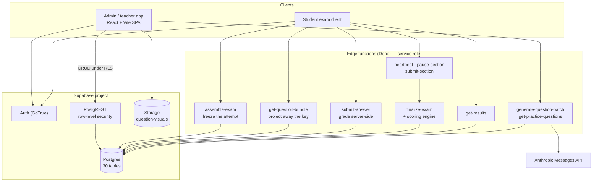
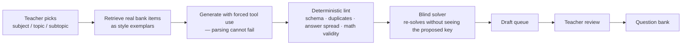

# Diagnostic Exam Platform

A full-stack assessment system: a question bank with authoring tools, an AI
question-generation pipeline with verification gates, a timed multi-section exam
runtime that survives refreshes and dropped connections, and a scoring engine
that turns an answer sheet into subject mastery, course-cluster fit, and a study
plan.

> ### About this repository
>
> This is a **public copy of a system I built and shipped**, rebuilt here as a
> portfolio repository. The code, schema, edge functions, scoring engine, AI
> pipeline and documentation are the real thing. What is deliberately **not**
> here is the operating data: the live question bank, student records, scoring
> weights tuned against real cohorts, credentials, and the deployed project's
> identifiers. Those stay private.
>
> In their place, `sample-data/` holds a small **synthetic** question bank I
> wrote for this repository — 58 fabricated items across all seven subjects,
> in the exact shape the importer and the runtime expect — and
> `supabase/seed.sql` holds a representative taxonomy slice. That is enough to
> stand the whole system up locally and watch it work end to end.
>
> See [DISCLOSURE.md](DISCLOSURE.md) for the full public/private boundary.

---

## The problem this solves

High-stakes entrance-exam preparation usually ends at a number. A student
learns they scored 61 and is handed a generic review plan.

The useful question is different: *what does this student actually understand,
what is holding them back, and which programmes is that profile a good fit
for?* Answering it means a system that can do four hard things correctly:

1. **Author and curate** thousands of exam-quality items — with passages, LaTeX
   mathematics, diagrams, and shared instruction blocks — without the bank
   drifting into inconsistency.
2. **Deliver a timed, high-stakes exam** over an unreliable connection, where a
   refresh, a dropped Wi-Fi connection, or a closed laptop must not cost the
   student time or answers, and must not let them gain any either.
3. **Grade and model** the result into something more informative than a
   percentage — subject mastery, subtopic gaps, fit against eight course
   clusters, readiness tier, predicted standing.
4. **Use AI to scale content** without letting a generated item reach a student
   unless it has survived deterministic checks, independent verification, and a
   human.

Each of those produces a distinct engineering problem, and most of what is
interesting in this repository is in how they are solved.

---

## Architecture



There is **no backend server of our own**. The admin app is a first-class
database client: it talks to PostgREST directly under the signed-in user's JWT,
filtered by row-level security. Everything that cannot be client-trusted lives
behind an edge function holding the service-role key.

That split is the central design decision, and the line is drawn by asking one
question of every operation: *would a hostile client break an invariant by
performing this itself?*

| Operation | Where it runs | Why |
|---|---|---|
| Browse, filter, edit the question bank | Browser → PostgREST | RLS is sufficient; an author is allowed to see what they author |
| Read an exam question | `get-question-bundle` | The row contains `correct_answer`. The function projects it away before responding — a row policy cannot, because the row itself is one the student is entitled to read |
| Submit an answer | `submit-answer` | Correctness is computed server-side against a key the client never receives |
| Advance the section clock | `heartbeat`, `submit-section` | A clock a client can edit is not a clock |
| Finalize and score | `finalize-exam` | Scores are written once from a trusted computation, not recalculated per page view |
| Generate questions | `generate-question-batch` | The model credential never reaches a browser |

Full walkthrough: **[docs/ARCHITECTURE.md](docs/ARCHITECTURE.md)**.

---

## Four problems worth reading the code for

### 1. An attempt is frozen the moment it starts

A template is an ordered list of 170 questions. Teachers keep editing templates
while students are sitting exams. If responses pointed at template rows, a save
during an attempt could reorder, add to, or delete out from under a live exam.

So `assemble-exam` snapshots the template into `session_questions`, and every
response hangs off the snapshot. The template becomes irrelevant the instant the
attempt begins. Deleting an exam is survivable too — a reserved tombstone
template parks orphaned sessions so a deletion can never strand a completed
attempt behind a dangling foreign key.

→ `supabase/functions/assemble-exam/index.ts`, `supabase/migrations/20260101000000_core_schema.sql`

### 2. A clock that is fair across a dropped connection

A timed section has a budget. The naive implementation — store `started_at`,
subtract from `now()` — charges a student for the twenty minutes their internet
was down. The equally naive opposite — count only time the tab was focused —
hands them an unlimited exam via the Wi-Fi switch.

The implementation separates three facts: `time_limit_seconds` (the immutable
budget), `elapsed_seconds` (time actually spent), and `last_activity_at` (when
the student was last observed). A heartbeat advances the clock in bounded
increments, so only observed-active intervals accrue, and a client that stops
reporting simply stops spending time rather than gaining any.

→ `supabase/functions/_shared/section-clock.ts` and its test suite

### 3. A scoring engine that is a pure function

Turning an answer sheet into a course-fit ranking is a long computation with
real subtlety, and it is the one part of the system where a silent bug is
expensive — wrong numbers look plausible.

```
graded responses
  ├─► perf(S)  = correct/total per subtopic                    → mastery band
  ├─► WPS(C)   = Σ perf(S)·imp(S,C) / Σ imp(S,C)               weighted performance
  ├─► CTR(C)   = passed / tested high-importance subtopics      coverage
  ├─► Fit(C)   = (α·WPS + β·CTR) · 100
  ├─► rank 8 clusters, tie-broken deterministically
  ├─► subject and topic scores, difficulty-weighted
  ├─► readiness tier, university predictive index
  └─► recommendations: strengths, gaps, study focus
```

`_shared/scoring-engine.ts` has no database access and no side effects — it takes
data in and returns results. `finalize-exam` is the only glue. That constraint
is what makes the engine testable at its boundaries, and the tests exist because
two real bugs of exactly this shape shipped: a coverage ratio that counted
never-tested subtopics as failures (capping every student below a full score),
and a cluster-to-subject mapping keyed on free-text labels where two entries
matched nothing at all, silently zeroing those clusters.

Both are written up honestly in [docs/ARCHITECTURE.md §5](docs/ARCHITECTURE.md),
along with what the schema should have done instead.

→ `supabase/functions/_shared/scoring-engine.ts` · `scoring-engine.test.ts`

### 4. AI generates candidates, never content

The generator is retrieval-grounded and schema-constrained, and the output is
treated as a proposal:



The two decisions that matter: output is **forced through a tool schema**, so
parsing never fails and a malformed item is impossible rather than merely
unlikely; and the answer key is **independently re-derived** by a solver pass
that cannot see the proposed answer, so a confidently wrong item fails the gate
instead of entering the bank.

Deterministic checks run before model checks, because linting is free and
catches most of the garbage — there is no point spending tokens verifying an
item with four identical distractors.

→ `supabase/functions/get-practice-questions/generate.ts` ·
`_shared/prompt-rules.ts` · `docs/AI-GENERATION-INTERNALS.md`

---

## Rendering is domain logic

Five files exist for rendering one question, which looks like over-engineering
until you try to display real exam content:

| File | Job |
|---|---|
| `src/mathContent.jsx` | Decides whether a string is mathematics, and how to render it |
| `src/mathParser2.jsx` | Plain-text math (`x^2`, `sqrt(x)`, `1/2`) → structured LaTeX |
| `src/questionText.jsx` | Underlines the exact phrase a stem refers to; renders `<seg>` error-identification markup |
| `src/visualContent.jsx` | Picks a viewer per asset type — inline SVG, image, PDF, video, audio |
| `src/questionExport.js` | CSV, HTML and DOCX export with passages and figures inlined |

Items arrive with LaTeX in some fields and plain-text math in others, with
diagrams either inline as SVG or uploaded to storage, with passages shared
across item groups, and with underlines that must land on a specific substring.
`npm run build` runs a guard first — `scripts/assert-svg-rendering-nondestructive.mjs`
fails the build if a change would reintroduce destructive SVG normalisation,
because that class of regression silently corrupts existing content rather than
throwing.

---

## Repository map

```
src/                     Admin app (React 19 + Vite, no router, no state library)
  App.jsx                Auth, question bank, CRUD, navigation
  ExamBuilder.jsx        Blueprint-driven 170-question exam authoring + auto-pick
  QuizBuilder.jsx        Flexible teacher-built quizzes
  StudentExamPreview.jsx Full student exam + results experience
  QuestionGenerator.jsx  AI generation UI
  CategoryManager.jsx    Taxonomy and importance-weight editor
  mathContent.jsx …      Rendering subsystem (see above)
  questionImport.js      Bulk CSV import with per-row validation
  questionExport.js      CSV / HTML / DOCX export

supabase/
  functions/             14 Deno edge functions
    _shared/             Scoring engine, section clock, prompt rules, utils (+ tests)
  migrations/            Schema, RLS, reference data, feature migrations
  seed.sql               Taxonomy slice and importance weights

sample-data/questions/   Synthetic question bank — 58 items, all seven subjects
scripts/                 Node maintenance and audit toolchain (see scripts/README.md)
docs/                    Architecture, schema, edge functions, AI pipeline, testing
```

---

## Running it

```bash
npm install
cp .env.example .env         # fill in your own Supabase project values

supabase db reset            # applies migrations + seed.sql
npm run dev                  # admin app on :5173
```

Then import the synthetic bank through the Question Bank tab's CSV upload, or
read [sample-data/README.md](sample-data/README.md) for the full path from an
empty database to a scored attempt.

```bash
npm test                     # math-pattern, CSV-import, and edge-function suites
npm run test:scoring         # scoring engine only (Deno)
npm run lint
npm run build                # runs the SVG regression guard, then vite build
```

Edge functions need Deno; the scoring and clock suites run under `deno test`.
Details in [docs/TESTING.md](docs/TESTING.md).

---

## Documentation

| Document | What it covers |
|---|---|
| [ARCHITECTURE.md](docs/ARCHITECTURE.md) | The whole system, end to end — including a candid section on remaining design debt |
| [ENGINEERING-DECISIONS.md](docs/ENGINEERING-DECISIONS.md) | The decisions, stated on their own: why each one, and what it buys |
| [AI-PIPELINE-OVERVIEW.md](docs/AI-PIPELINE-OVERVIEW.md) | The generation and verification pipeline at a glance |
| [SCHEMA-REFERENCE.md](docs/SCHEMA-REFERENCE.md) | Every table, column, constraint and relationship |
| [EDGE-FUNCTIONS.md](docs/EDGE-FUNCTIONS.md) | All 14 functions, their contracts, deployment and debugging |
| [AI-GENERATION-INTERNALS.md](docs/AI-GENERATION-INTERNALS.md) | The generation engine in detail |
| [QUESTION-GENERATION-GUIDE.md](docs/QUESTION-GENERATION-GUIDE.md) | The safe, reversible procedure for deepening the bank |
| [AI-ROADMAP.md](docs/AI-ROADMAP.md) | Design document for the next generation of generation and QA agents |
| [EXAM-BUILDER.md](docs/EXAM-BUILDER.md) | Code walkthrough of the largest component |
| [QUESTION-BANK-OPERATIONS.md](docs/QUESTION-BANK-OPERATIONS.md) | Day-to-day bank operations |
| [MATH-RENDERING.md](docs/MATH-RENDERING.md) | The mathematics rendering contract |
| [TESTING.md](docs/TESTING.md) | What is tested, what is not, and how to run it |
| [DISCLOSURE.md](DISCLOSURE.md) | What is public here and what is not |

---

## Stack

React 19 · Vite 8 · KaTeX · Supabase (Postgres, PostgREST, GoTrue, Storage) ·
Deno edge functions · Anthropic Messages API · Vercel · Node tooling · Deno test

---

## Author

Built by [Juanlo Policarpio](https://github.com/juanlopolicaarpio) — product
design, schema, frontend, edge functions, scoring model, AI pipeline, and
documentation.

Copyright © 2026 Juanlo Policarpio. All rights reserved. See [LICENSE](LICENSE).
